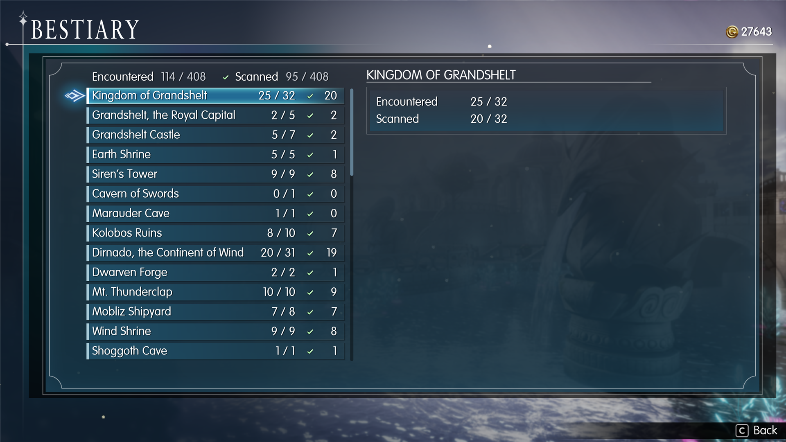
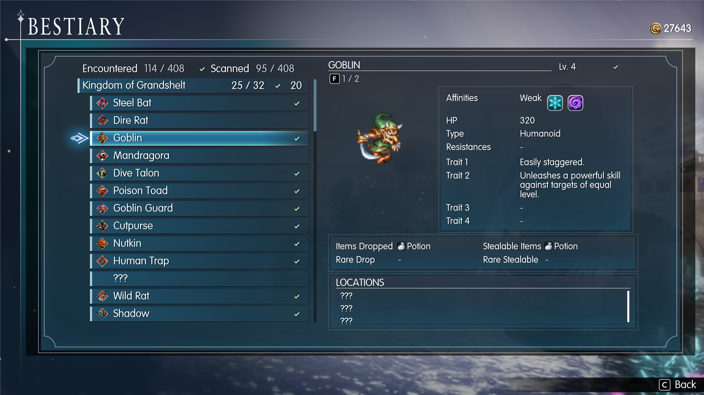
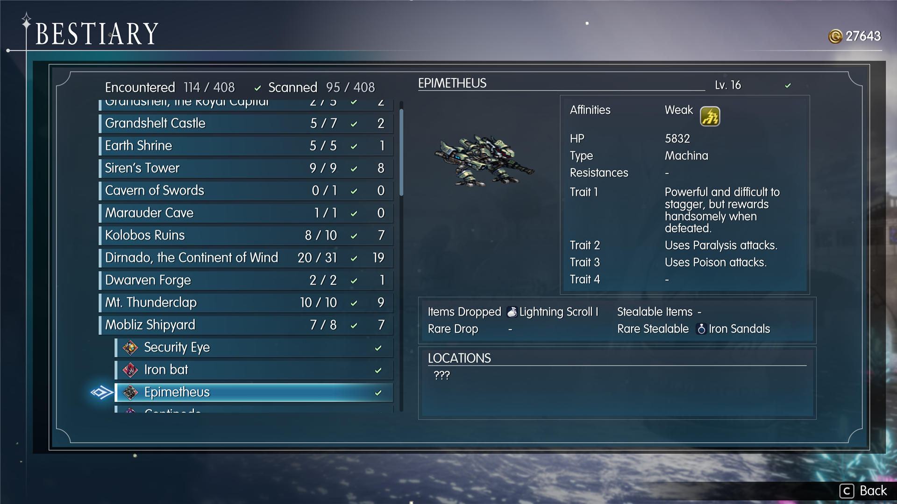

# FFR Bestiary (MogHub edition)

A bestiary for **FINAL FANTASY RESONANCE** (Steam, PC). It adds a **Bestiary** page to the main menu: every enemy
you have met, grouped by area, with the game's own scan (Libra) details once you have scanned it, its animated
battle sprite, and where it can be found.

This is a fork of [FFR Bestiary](https://github.com/Law19902/ffr-bestiary) by Law19902, rebuilt as a plugin for
**[MogHub](../../README.md)**, the FFR mod framework: MogHub provides the menu entry (no pak of its own), the screen's widgets and
list, per-save storage and the game's events.

> First release, made for community feedback - expect rough edges. Bug reports and suggestions are very welcome in
> [Issues](../../issues).

## Features
- Enemies grouped by area, with encountered / scanned counts for each area and for the whole game
- Unmet enemies of areas you have visited show as `???`, so you can see what is left to find
- Full scan details once scanned: affinities, HP, type, resistances, traits, drops and steals (before a scan, only
  what the battle screen has already shown you)
- Animated battle sprites and the battle timeline's face icons
- Encounter locations: places you have met the enemy are named, the rest show `???`
- Enemies with several forms or phases: Left / Right (or Q / E) steps through them
- **Show all monsters** (a setting in Mods > FFR Bestiary): every monster listed, the unmet ones dimmed, while the
  counts stay what you really met
- **Libra by hand**: confirm on an enemy switches its scan data on or off, whatever your save says
- Installing part-way through the game picks up what your save already records (enemies defeated or scanned, areas
  visited)
- Works with controller and keyboard; uses the game's own fonts, panels and icons

## Install
1. Install [MogHub](../../README.md) (it comes with its own instructions, including the one-time UE4SS setup).
2. Extract `FFRBestiary-<version>.zip` into the game folder (the one containing `FFRS`). It adds
   `FFRS\Binaries\Win64\ue4ss\Mods\FFRBestiary`. Bestiary appears in the main menu above System.

Don't install the original FFR Bestiary alongside (delete its `FFRS\Content\Paks\~mods\zzz_FFRBestiary_P.*` files):
both would add a Bestiary entry. Its progress files work with this version.

**Uninstall:** delete the folder, or switch the plugin off in main menu > Mods. **Your game saves are never
written**; Bestiary progress lives in its own files in the plugin folder (`saves\`, one per save slot).

Made for game version 1.0.1.0.

## How it works
- A MogHub plugin (`runtime/FFRBestiary`): `moghub.lua` registers the screen and settings; `Scripts/ui.lua` builds
  the page in the game's Help layout with MogHub's `kit.ui` and `kit.list`, `tracker.lua` notes the enemies met in
  battle, `store.lua` keeps progress with the game's saves, `libra.lua` keeps the Libra choices made by hand, and
  `game.lua` holds what depends on the game's build.
- `data/bestiary_data.*` holds IDs, numbers and string-table keys only; all names and text come from the game at
  runtime, in your game's language.

## Building from source
Developer notes are in [docs/NOTES.md](docs/NOTES.md) and the original design in [docs/SPEC.md](docs/SPEC.md).
The data tools need the game's files extracted locally (`tools/ffr-dump`, a CUE4Parse dumper; a `.usmap` from
UE4SS) - nothing extracted is committed. `tools/export_data.py` writes the data file, `tools/make_release.sh` the
zip. During development, the repository's `tools/deploy.sh` installs it next to MogHub.

## Credits and licence
- Mod code: MIT licence ([LICENSE](LICENSE)). Original FFR Bestiary by Law19902; MogHub port by jesus-seijas-sp.
- Runs on MogHub and [UE4SS](https://github.com/UE4SS-RE/RE-UE4SS) (MIT, installed separately).
- The data tools use [CUE4Parse](https://github.com/FabianFG/CUE4Parse); recon was helped by the open-source
  FFR Vision Studio project.

FINAL FANTASY RESONANCE is © SQUARE ENIX. This is an unofficial fan mod, not affiliated with or endorsed by
Square Enix.
